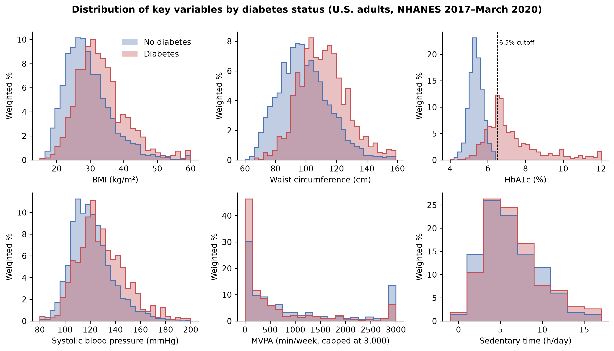
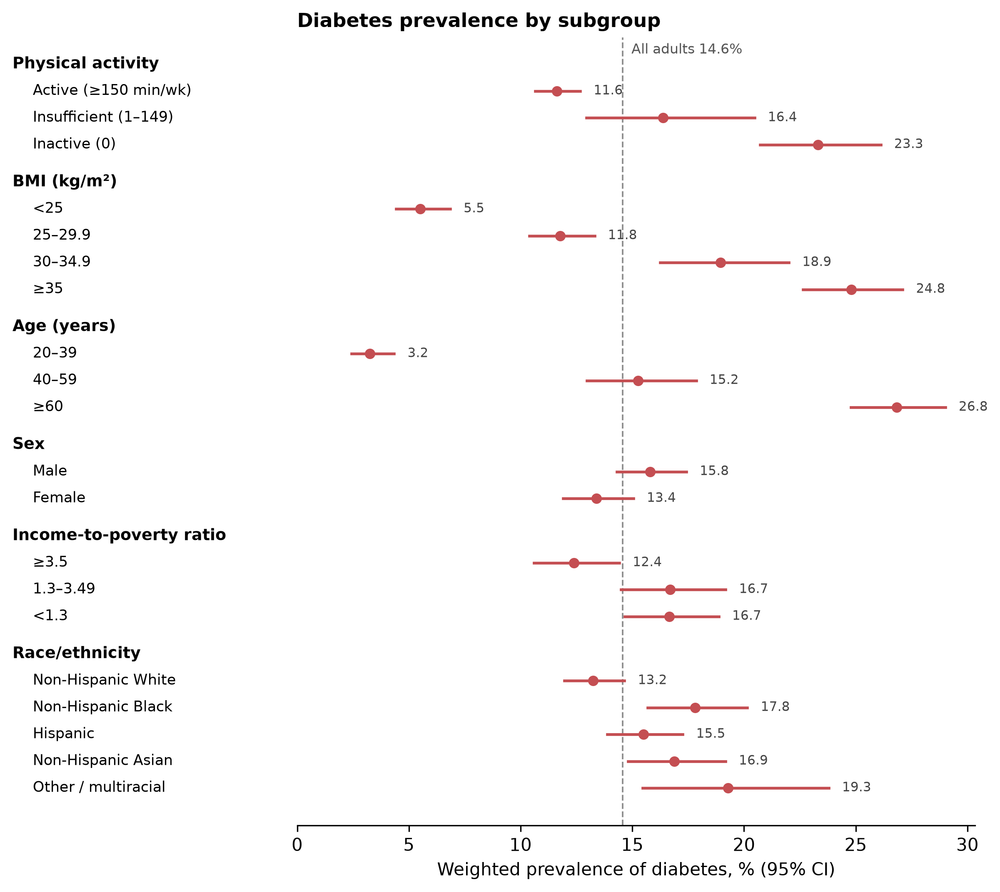
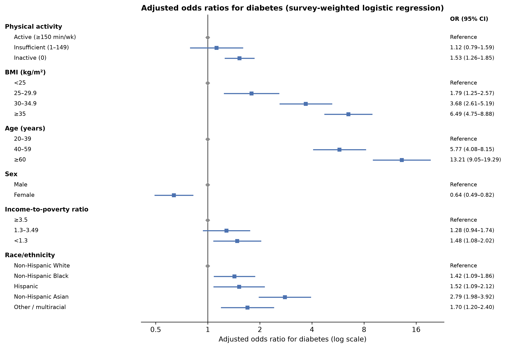
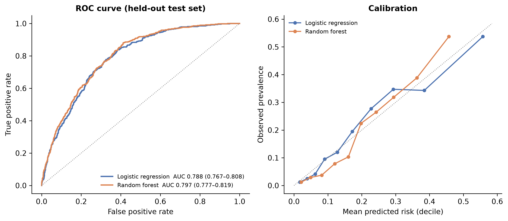
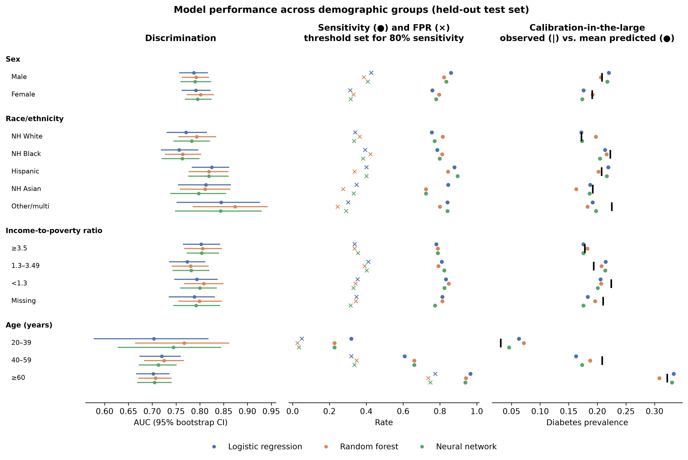
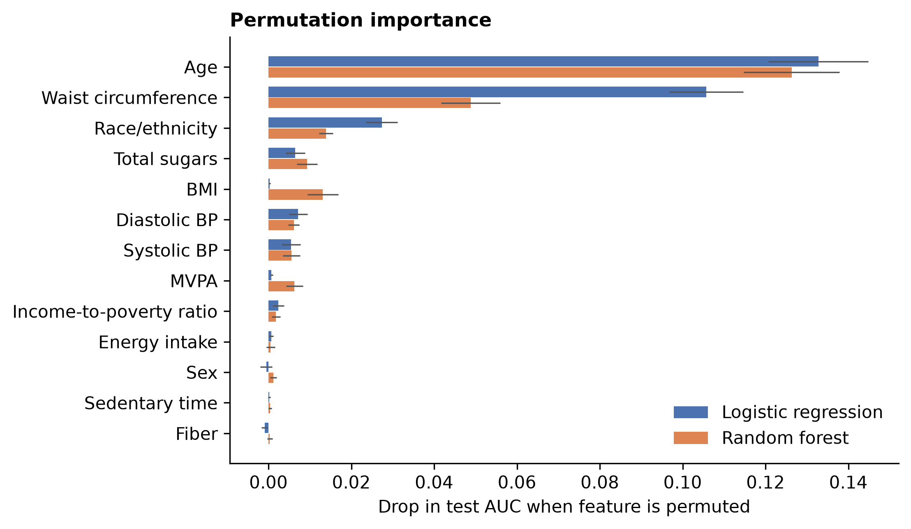

# Lifestyle and metabolic risk in U.S. adults: an analysis of NHANES 2017–March 2020

A survey-weighted analysis of how physical activity, body size, and socioeconomic factors relate to diabetes in a nationally representative sample of U.S. adults, with an independent replication of the main model in R and a machine-learning screening analysis that looks at performance across demographic groups.

**Summary.** Among 8,063 adults (representing 228.8 million people), 14.6% had diabetes, and about one in six of those cases was undiagnosed. After adjustment for BMI, age, sex, income, and race/ethnicity, adults who reported no moderate-to-vigorous physical activity had 1.53 times the odds of diabetes compared with those meeting activity guidelines (95% CI 1.26–1.85). BMI showed a steep gradient (OR 6.49 for BMI ≥35 vs <25). The survey-weighted Python estimates match R's `survey` package to within 10⁻⁷. A random forest using only non-laboratory measures did not outperform logistic regression (AUC 0.797 vs 0.788). With a single risk threshold, both models missed most cases in adults under 40.

---

## 1. Question

1. How common is diabetes, diagnosed and undiagnosed, among U.S. adults, and how does prevalence differ by activity level, BMI, age, sex, income, and race/ethnicity?
2. Is physical inactivity associated with diabetes independently of BMI and sociodemographic factors?
3. Can a model built only from measures that need no blood draw identify adults with diabetes, and does it work equally well across demographic groups?

## 2. Data

The National Health and Nutrition Examination Survey (NHANES) is a continuous, nationally representative survey of the U.S. civilian non-institutionalized population, run by the National Center for Health Statistics (NCHS). Data collection for the 2019–2020 cycle stopped in March 2020 because of COVID-19, so NCHS combined it with 2017–2018 into a single **2017–March 2020 pre-pandemic file** with its own sampling weights (`P_` prefix).

| File | Content | Key variables |
|---|---|---|
| `P_DEMO` | Demographics, design variables, weights | age, sex, race/ethnicity, income-to-poverty ratio, `SDMVSTRA`, `SDMVPSU`, `WTMECPRP` |
| `P_BMX` | Body measures | height, weight, BMI, waist circumference |
| `P_BPXO` | Oscillometric blood pressure | three systolic/diastolic readings |
| `P_GHB` | Glycohemoglobin | HbA1c (%) |
| `P_GLU` | Fasting plasma glucose (morning subsample) | FPG, fasting subsample weight `WTSAFPRP` |
| `P_DIQ` | Diabetes questionnaire | doctor-diagnosed diabetes |
| `P_PAQ` | Physical activity questionnaire | days/minutes of vigorous and moderate work, transport, and recreation; sedentary time |
| `P_DR1TOT` | Day-1 24-hour dietary recall totals | energy, carbohydrate, sugars, fiber, saturated fat, sodium |

Files are downloaded directly from CDC by `scripts/01_download.py` and merged one-to-one on the respondent ID `SEQN`.

## 3. Methods

### Study population

```
All 2017–March 2020 participants                      15,560
  Examined at the mobile examination center           14,300
  Age ≥ 20 years                                        8,544
  Not pregnant                                          8,457
  Diabetes status determinable  → analytic sample       8,063   (Table 1, prevalence)
  Physical activity, BMI, income available → model      6,711   (regression)
```

### Definitions

- **Diabetes**: self-reported physician diagnosis (`DIQ010 = 1`) *or* HbA1c ≥ 6.5% (ADA diagnostic threshold). **Undiagnosed** diabetes is HbA1c ≥ 6.5% without a reported diagnosis. "Borderline" responses count as no diagnosis, following CDC surveillance definitions.
- **Physical activity**: moderate-to-vigorous physical activity (MVPA) in moderate-equivalent minutes per week, summed across work, transport, and recreation, with vigorous minutes counted double. Categories follow the 2018 Physical Activity Guidelines: *active* (≥150 min/week), *insufficient* (1–149), *inactive* (0).
- **BMI**: <25 (reference; includes the few underweight adults), 25–29.9, 30–34.9, ≥35 kg/m².
- **Income**: family income-to-poverty ratio (PIR) <1.3, 1.3–3.49, ≥3.5. These cut points are used for federal nutrition-assistance eligibility.
- **Race/ethnicity**: from `RIDRETH3`; Mexican American and Other Hispanic are combined.

### Data quality control

`scripts/02_clean_qc.py` applies rules in a fixed order and logs counts before and after each one ([`results/qc_report.md`](results/qc_report.md)):

1. **Structure.** Confirms one row per `SEQN` in every file, that every ID matches the demographics file, and that no records are duplicated. Twelve records were identical apart from `SEQN`. On inspection they are six pairs of child twins with household-level weights, so they were kept.
2. **Read artifact.** `pandas.read_sas` returns SAS zeros as `5.4e-79`. 4,405 such values (in age, income, weights, sedentary time, and diet) were recoded to 0.
3. **Special codes.** Refused/don't-know codes (7/9, 77/99, 7777/9999) were set to missing.
4. **Physiologic plausibility (adults).** Height, weight, BMI, waist, blood pressure, HbA1c, glucose, and activity minutes outside defined ranges were set to missing. A blood pressure reading with diastolic ≥ systolic was dropped.
5. **Physical activity.** Participants reporting more than 960 minutes (16 hours) of activity per day across domains had their activity set to missing (148 people; this is the standard IPAQ cleaning rule).
6. **Diet.** Recalls that were not complete and reliable, or had implausible energy intake (Willett ranges: men 800–4,200, women 500–3,500 kcal/day), were set to missing (901 people).
7. **Outliers.** Values beyond 3×IQR were *flagged but kept*. After the plausibility rules they are extreme but real, and removing them would bias estimates toward the healthy middle.

### Statistical analysis

NHANES is a stratified, multistage probability sample. Every analysis uses the MEC exam weights (`WTMECPRP`), strata (`SDMVSTRA`, 24 strata), and primary sampling units (`SDMVPSU`, 49 PSUs), giving **25 design degrees of freedom**. Variances are estimated by Taylor-series linearization, treating PSUs as sampled with replacement within strata. Subpopulations (adults, people with diabetes, and so on) are analyzed as domains, keeping all PSUs in the variance calculation rather than dropping rows before estimation, as the NCHS analytic guidelines recommend.

- **Table 1**: unweighted counts with weighted percentages, and weighted means (SE). p-values come from design-based Wald t-tests (continuous variables) and adjusted Wald F-tests (categorical variables).
- **Main model**: survey-weighted logistic regression of diabetes on physical activity, BMI category, age group, sex, PIR category, and race/ethnicity. Race/ethnicity is included as a confounder because it is associated with activity patterns, BMI distribution, and diabetes risk. Odds ratios have 95% Wald CIs using the *t* distribution with 25 df.
- **Python implementation**: the design-based estimators (means, proportions, logit-scale CIs, the logistic sandwich variance) are written out in [`scripts/svy.py`](scripts/svy.py) rather than called from a black-box library.
- **Validation in R**: [`R/svyglm_check.R`](R/svyglm_check.R) refits the main model with `survey::svyglm` (quasibinomial family) on a design built from the full exam sample, then compares the estimates term by term with the Python output.
- **Sensitivity analyses**: (a) the unweighted model, to show what ignoring the design does; (b) missing income kept as its own category instead of excluding those participants; (c) diabetes redefined to include fasting plasma glucose ≥126 mg/dL, restricted to the fasting subsample with fasting weights (`WTSAFPRP`).

### Machine learning

The outcome is the same diabetes indicator, in the analytic sample. **HbA1c and glucose are excluded as predictors because HbA1c defines the outcome**, so the task is to identify diabetes from measures you could collect without a blood draw: age, sex, race/ethnicity, PIR, BMI, waist circumference, blood pressure, MVPA, sedentary time, and day-1 energy, sugar, and fiber intake. Missing values are median-imputed with missingness indicators, inside the cross-validation pipeline.

- 70/30 split stratified on the outcome (seed 2020). The random forest's leaf size and number of features per split are tuned by 5-fold cross-validated AUC on the training set.
- Test-set AUC with stratified bootstrap 95% CIs (1,000 resamples), a paired bootstrap for the AUC difference, survey-weighted AUC, Brier score, and decile calibration.
- **Fairness**: for each sex, race/ethnicity, income, and age group: AUC, sensitivity, and false-positive rate at a threshold chosen on out-of-fold *training* predictions to give 80% overall sensitivity, plus observed vs. mean predicted prevalence.

## 4. Results

### Participant characteristics

Adults with diabetes were older (mean 60.7 vs 46.7 years), had higher BMI (33.2 vs 29.2 kg/m²) and waist circumference, and were more likely to be inactive (33.4% vs 18.8%) and to have lower income.

| Characteristic | Overall | No diabetes | Diabetes | p-value |
|:---|---:|---:|---:|---:|
| Participants, n | 8,063 | 6,458 | 1,605 |  |
| Weighted population, millions | 228.8 | 195.5 | 33.3 |  |
| Age, years, mean (SE) | 48.7 (0.6) | 46.7 (0.6) | 60.7 (0.7) | <0.001 |
| Age (years), n (%) |  |  |  | <0.001 |
| &nbsp;&nbsp;&nbsp;20-39 | 2,355 (35.0) | 2,266 (39.6) | 89 (7.8) |  |
| &nbsp;&nbsp;&nbsp;40-59 | 2,684 (34.7) | 2,167 (34.4) | 517 (36.3) |  |
| &nbsp;&nbsp;&nbsp;60+ | 3,024 (30.3) | 2,025 (26.0) | 999 (55.8) |  |
| Sex, n (%) |  |  |  | 0.065 |
| &nbsp;&nbsp;&nbsp;Female | 4,134 (51.4) | 3,373 (52.1) | 761 (47.3) |  |
| &nbsp;&nbsp;&nbsp;Male | 3,929 (48.6) | 3,085 (47.9) | 844 (52.7) |  |
| Race/ethnicity, n (%) |  |  |  | 0.011 |
| &nbsp;&nbsp;&nbsp;Non-Hispanic White | 2,821 (63.1) | 2,346 (64.1) | 475 (57.4) |  |
| &nbsp;&nbsp;&nbsp;Non-Hispanic Black | 2,090 (11.0) | 1,621 (10.6) | 469 (13.4) |  |
| &nbsp;&nbsp;&nbsp;Hispanic | 1,798 (16.0) | 1,409 (15.9) | 389 (17.1) |  |
| &nbsp;&nbsp;&nbsp;Non-Hispanic Asian | 968 (5.8) | 779 (5.7) | 189 (6.8) |  |
| &nbsp;&nbsp;&nbsp;Other / multiracial | 386 (4.1) | 303 (3.8) | 83 (5.4) |  |
| Income-to-poverty ratio, n (%) |  |  |  | 0.037 |
| &nbsp;&nbsp;&nbsp;<1.3 | 1,958 (18.7) | 1,527 (18.3) | 431 (21.2) |  |
| &nbsp;&nbsp;&nbsp;1.3-3.49 | 2,751 (35.0) | 2,180 (34.2) | 571 (39.8) |  |
| &nbsp;&nbsp;&nbsp;>=3.5 | 2,253 (46.3) | 1,869 (47.5) | 384 (39.0) |  |
| &nbsp;&nbsp;&nbsp;Missing | 1,101 | 882 | 219 |  |
| BMI, kg/m², mean (SE) | 29.8 (0.2) | 29.2 (0.2) | 33.2 (0.3) | <0.001 |
| BMI (kg/m²), n (%) |  |  |  | <0.001 |
| &nbsp;&nbsp;&nbsp;<25 | 1,987 (25.9) | 1,799 (28.6) | 188 (9.9) |  |
| &nbsp;&nbsp;&nbsp;25-29.9 | 2,542 (32.0) | 2,099 (33.0) | 443 (26.3) |  |
| &nbsp;&nbsp;&nbsp;30-34.9 | 1,735 (22.1) | 1,315 (20.9) | 420 (29.2) |  |
| &nbsp;&nbsp;&nbsp;>=35 | 1,661 (20.0) | 1,156 (17.6) | 505 (34.6) |  |
| &nbsp;&nbsp;&nbsp;Missing | 138 | 89 | 49 |  |
| Waist circumference, cm, mean (SE) | 100.7 (0.5) | 99.0 (0.5) | 111.3 (0.6) | <0.001 |
| Physical activity, n (%) |  |  |  | <0.001 |
| &nbsp;&nbsp;&nbsp;Active (≥150 min/wk) | 4,846 (67.5) | 4,086 (69.9) | 760 (53.7) |  |
| &nbsp;&nbsp;&nbsp;Insufficient (1–149) | 989 (11.5) | 769 (11.3) | 220 (12.9) |  |
| &nbsp;&nbsp;&nbsp;Inactive (0) | 2,042 (21.0) | 1,448 (18.8) | 594 (33.4) |  |
| &nbsp;&nbsp;&nbsp;Missing | 186 | 155 | 31 |  |
| Sedentary time, h/day, mean (SE) | 5.9 (0.1) | 5.9 (0.1) | 6.2 (0.1) | 0.038 |
| Systolic BP, mmHg, mean (SE) | 122.1 (0.4) | 121.0 (0.4) | 129.0 (0.9) | <0.001 |
| HbA1c, %, mean (SE) | 5.69 (0.02) | 5.42 (0.01) | 7.33 (0.07) | <0.001 |
| Undiagnosed (HbA1c ≥6.5%, no prior diagnosis), % (SE) |  |  | 16.4 (1.1) |  |

*Counts unweighted; percentages, means, and SEs weighted (WTMECPRP) and design-adjusted. Percentages exclude missing values.*



### Prevalence

Weighted diabetes prevalence was **14.6% (95% CI 13.7–15.5)**, and 2.4% of all adults had undiagnosed diabetes. As a check on the pipeline, the estimates line up closely with CDC's National Diabetes Statistics Report for the same survey cycle. CDC's definition differs slightly (adults ≥18, and FPG used in addition to HbA1c):

| | This analysis | CDC NDSR (2017–2020) |
|---|---:|---:|
| Total diabetes | 14.6 (13.7–15.5) | 14.7 (13.2–16.4) |
| Non-Hispanic White | 13.2 (12.0–14.6) | 13.6 (11.4–16.2) |
| Non-Hispanic Black | 17.8 (15.7–20.2) | 17.4 (15.2–19.8) |
| Hispanic | 15.5 (13.9–17.3) | 15.5 (13.8–17.3) |
| Non-Hispanic Asian | 16.9 (14.8–19.2) | 16.7 (14.0–19.8) |

Adding fasting glucose in the fasting subsample (n = 3,757) raises total prevalence to 16.2% (14.3–18.3) and undiagnosed prevalence to 4.6% (3.8–5.4). HbA1c alone misses a meaningful share of undiagnosed cases.



### Survey-weighted logistic regression (n = 6,711)



- **Physical activity**: inactivity was associated with 53% higher odds of diabetes (OR 1.53, 1.26–1.85) independent of BMI. Insufficient activity was not clearly different from meeting guidelines (OR 1.12, 0.79–1.59).
- **BMI**: a dose-response gradient: OR 1.79 (25–29.9), 3.68 (30–34.9), 6.49 (≥35).
- **Age and sex**: age was the strongest factor (OR 13.2 for ≥60 vs 20–39). Women had lower odds than men (OR 0.64, 0.49–0.82).
- **Income**: PIR <1.3 vs ≥3.5, OR 1.48 (1.08–2.02).
- **Race/ethnicity**: at the same BMI, non-Hispanic Asian adults had the highest odds of diabetes (OR 2.79, 1.98–3.92). This is consistent with evidence that Asian Americans develop diabetes at lower BMI, the basis for the ADA's lower BMI screening cut point (≥23) for this group.

### Python vs. R

| | Max absolute difference (15 coefficients) |
|---|---:|
| Log-odds ratio | 3.5 × 10⁻¹² |
| Standard error | 3.5 × 10⁻⁸ |

Full term-by-term comparison: [`results/python_vs_r.csv`](results/python_vs_r.csv). The R script also reproduces the weighted prevalence (0.1456) and the group mean BMIs behind Table 1.

### Sensitivity analyses

| Model | n | Inactive | Insufficient | BMI ≥35 | NH Asian |
|---|---:|---:|---:|---:|---:|
| Main (survey-weighted) | 6,711 | 1.53 (1.26–1.85) | 1.12 (0.79–1.59) | 6.49 (4.75–8.88) | 2.79 (1.98–3.92) |
| Unweighted, ignores design | 6,711 | 1.53 (1.32–1.78) | 1.30 (1.06–1.58) | 5.34 (4.28–6.67) | 2.55 (2.02–3.22) |
| Missing income as a category | 7,740 | 1.54 (1.31–1.81) | 1.07 (0.78–1.48) | 6.21 (4.70–8.22) | 2.80 (2.05–3.83) |
| Diabetes incl. FPG ≥126 (fasting subsample) | 3,142 | 1.32 (0.93–1.88) | 0.81 (0.52–1.26) | 8.76 (5.10–15.03) | 2.84 (1.95–4.15) |

Keeping participants with missing income changes almost nothing. The unweighted model shows why the design matters. Its confidence intervals are too narrow because they ignore clustering, which is enough to make "insufficient activity" look statistically significant when the design-based estimate is not. It also understates the BMI ≥35 association, because the sample over-represents some groups. In the fasting subsample the inactivity estimate is smaller and its CI crosses 1. This analysis has less than half the sample size, so it is less precise, but it does suggest the main estimate should not be over-interpreted.

### Machine learning

| Model | Test AUC (95% CI) | Survey-weighted AUC | Brier score |
|---|---:|---:|---:|
| Logistic regression | 0.788 (0.767–0.808) | 0.818 | 0.133 |
| Random forest (tuned) | 0.797 (0.777–0.819) | 0.829 | 0.132 |

The random forest's advantage was small and not statistically clear (ΔAUC +0.009, 95% CI −0.001 to +0.019). With about a dozen mostly continuous predictors and largely monotonic relationships, a linear model captures nearly all of the signal. Both models were reasonably calibrated. Age and waist circumference dominated permutation importance.





Fairness findings, held-out test set:

- **Age is where a single threshold fails.** At a cutoff giving 80% sensitivity overall, the models detected only 32% (logistic) and 23% (random forest) of cases in adults aged 20–39. In adults ≥60 they detected 94–97%, but at the cost of flagging about three-quarters of those without diabetes. Within-age AUCs (0.70–0.77) are much lower than the overall AUC, so a large share of the overall discrimination comes from age itself. The 20–39 estimates are imprecise (22 cases in the test set).
- **Calibration by age** is also off: predicted risk is roughly double the observed prevalence in 20–39 year olds and too low in 40–59 year olds.
- **Race/ethnicity.** Discrimination was lowest for non-Hispanic Black adults (AUC 0.76) and highest for Hispanic and multiracial adults (0.82–0.87). The random forest's sensitivity for non-Hispanic Asian adults was notably lower than logistic regression's (72% vs 85%). This is consistent with the regression result: Asian adults with diabetes tend to have lower BMI and waist circumference, which a tree model leaning on body-size thresholds is more likely to miss.
- **Sex and income.** Differences were small, with overlapping CIs.



## 5. Discussion

Physical inactivity was associated with diabetes beyond what BMI explains, but the association was modest compared with body size and age. Because the data are cross-sectional, the direction cannot be established. People diagnosed with diabetes are routinely counselled to exercise, and poor health can itself reduce activity, so the inactivity estimate could be biased in either direction. The near-identical Python and R results show that the hand-written survey estimators are correct, and the close agreement with CDC's published prevalence estimates checks the data pipeline and outcome definition.

For screening, the practical lesson is that model choice mattered much less than threshold choice. One global cutoff on a model that relies heavily on age concentrates false negatives among younger adults, the group with the most years of life to gain from early detection. Age-specific thresholds or recalibration would be a natural next step.

## 6. Limitations

- **Cross-sectional design**: associations only, with possible reverse causation (see above).
- **Self-reported activity**: the NHANES questionnaire (based on the WHO GPAQ) is prone to over-reporting, and it counts occupational activity, which may have different health effects from leisure activity. Accelerometry was not collected in this cycle.
- **Outcome misclassification**: a single HbA1c measurement without confirmatory testing. HbA1c is affected by anemia and hemoglobin variants, which are more common in some racial/ethnic groups, so misclassification may not be uniform across groups. Type 1 and type 2 diabetes are not distinguished.
- **Missing income** (13.7%): the main model is a complete-case analysis. The missing-category sensitivity analysis gave nearly identical results, but data missing not at random can't be ruled out.
- **Limited design degrees of freedom** (25): this restricts how many parameters a design-based model can reliably support and makes multi-parameter joint tests unstable.
- **Pre-pandemic file**: the 2019–March 2020 portion is not nationally representative on its own. NCHS weights make the combined file representative for 2017–March 2020.
- **Machine learning**: a single dataset with one train/test split and no external validation. Training was unweighted. Subgroup estimates for small groups are imprecise. Using race/ethnicity as a predictor raises its own fairness questions. Dropping it, and seeing which groups lose or gain performance, is a worthwhile extension.

## 7. Reproducing the analysis

Requirements: Python 3.12+ (tested on 3.13), R with the `survey` package (tested on R 4.6, survey 4.5), and `make`. The full pipeline runs in about 1.5 minutes and downloads ~31 MB from CDC.

```bash
python3 -m venv .venv
source .venv/bin/activate
pip install -r requirements.txt
Rscript -e 'install.packages("survey", repos = "https://cloud.r-project.org")'

make all
```

Or run steps individually:

```bash
python scripts/01_download.py     # download XPT files, merge on SEQN
python scripts/02_clean_qc.py     # QC report + analytic dataset
python scripts/03_table1.py       # Table 1
python scripts/04_analysis.py     # descriptives, prevalence, regression, sensitivity
python scripts/05_figures.py      # figures 1–3
python scripts/06_ml.py           # ML comparison, fairness, figures 4–6
Rscript R/svyglm_check.R          # R replication and comparison
```

```
├── data/
│   ├── raw/                 # CDC XPT files (downloaded, not tracked)
│   └── processed/           # merged and analytic CSVs (generated, not tracked)
├── scripts/
│   ├── nhanes.py            # paths, variable lists, category levels, plot style
│   ├── svy.py               # design-based estimators (Taylor linearization)
│   └── 01–06_*.py           # pipeline steps
├── R/
│   └── svyglm_check.R
├── results/                 # QC report, Table 1, model estimates, ML metrics
├── figures/
├── Makefile
└── requirements.txt
```

## References

1. Akinbami LJ, et al. National Health and Nutrition Examination Survey, 2017–March 2020 prepandemic file: sample design, estimation, and analytic guidelines. *Vital Health Stat 1*. 2022;(190).
2. Centers for Disease Control and Prevention. [National Diabetes Statistics Report](https://www.cdc.gov/diabetes/php/data-research/index.html). 2024.
3. American Diabetes Association Professional Practice Committee. Diagnosis and classification of diabetes: Standards of Care in Diabetes. *Diabetes Care*.
4. Piercy KL, et al. The Physical Activity Guidelines for Americans. *JAMA*. 2018;320(19):2020–2028.
5. Lumley T. Analysis of complex survey samples. *J Stat Softw*. 2004;9(8):1–19.
6. Hsu WC, et al. BMI cut points to identify at-risk Asian Americans for type 2 diabetes screening. *Diabetes Care*. 2015;38(1):150–158.
7. Willett W. *Nutritional Epidemiology*. 3rd ed. Oxford University Press; 2012.
8. IPAQ Research Committee. Guidelines for data processing and analysis of the International Physical Activity Questionnaire. 2005.
